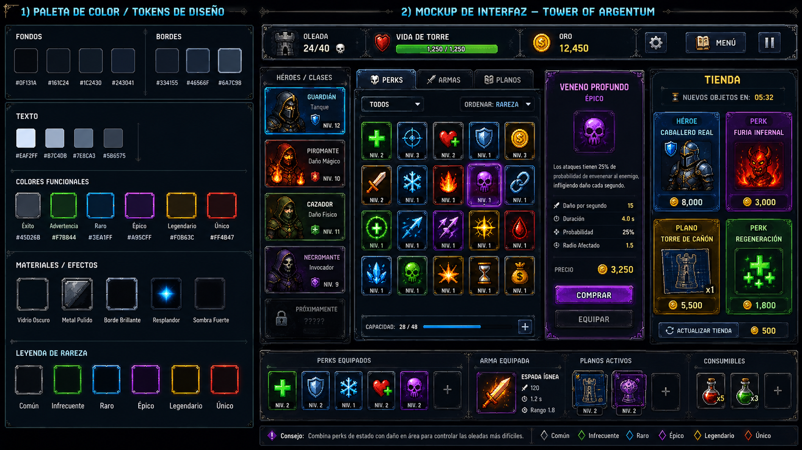

<div align="center">

# Tower of Argentum — Resources

**El arte y el audio del juego, con su índice y su pipeline. Repo hermano del [Client](https://github.com/TowerDefenderAO/Client), a propósito fuera del proyecto Godot.**




</div>

---

## Por qué es un repo aparte

Godot no importa esta carpeta: no genera `.import`, no la mete en el `.pck` del ejecutable y no la reimporta en cada clon. El arte viaja en un **`arte.pck` propio**, armado con `--empaquetar-arte` desde el cliente, con los PNG **crudos** —el juego hornea el piso con `Image.BlitRect` y eso necesita píxeles RGBA, no texturas comprimidas para la GPU—. Así el ejecutable queda chico y el arte se parchea sin reexportar el juego.

**Se versiona la fuente, nunca lo horneado.** El atlas, los originales 1x (`.orig`) y las cachés están bloqueados en el `.gitignore`; la lección viene de un repo hermano cuyo `.git` llegó a 4,7 GB por versionar un atlas de 1,6 GB.

## Qué hay

| Carpeta / archivo | Qué es |
|---|---|
| `1.PNG` … `108.PNG` | Las hojas de sprites. Cada una es una **hoja**, no un sprite: trae varias regiones |
| [graficos.json](graficos.json) | El índice: 366 gráficos, cada uno con su hoja, su región `[x, y, w, h]`, sus cuadros de animación y su **origen** en Argentum Online |
| [perks/](perks/) | 70 iconos de perks recortados de una lámina, más [iconos.json](perks/iconos.json) con las coordenadas y el perk que usa cada uno, y el script que los regenera |
| [ui/](ui/) | 25 piezas de interfaz (paneles, botones, barras, slots por rareza, tabs) con su margen de 9-slice en [pieces.json](ui/pieces/pieces.json) |
| [Audio/](Audio/) | 76 sonidos y temas, todos **CC0**, con la **evidencia de licencia** de cada paquete (la página original, el checksum del zip y el campo de licencia detectado), un manifiesto y los scripts que los bajan y los copian |
| [Icon Project/](Icon%20Project/) | El ícono del juego en todos los tamaños |

### El índice

Nadie deriva una clave de gráfico en runtime: los importadores las escriben y el que dibuja las lee. Cada entrada es trazable al gráfico original de Argentum Online:

```jsonc
"bicho.hormiga.norte": {
  "fileNum": 63,                        // la hoja de ESTE repo, no el número de AO
  "x": 131, "y": 60, "w": 75, "h": 55,  // el primer cuadro
  "frames": 3,
  "regiones": [[131, 60, 75, 55], [2, 118, 75, 55], [79, 118, 75, 55]],
  "msPorFrame": 55,
  "origen": "AO npc=0 «Hormiga» área=1 body=70 dir=norte grh=4743 hoja=358",
  "escala": 4
}
```

Por prefijo: `bicho.` (168, el bestiario, con sus cuatro direcciones), `arma.` (52), `raza.` (40), `cuerpo.` (32), `item.` (21), `piso.` (13) y `cabeza.` (8). Una sola escala, x4: todas las coordenadas ya están en ese espacio.

## El pipeline

Las hojas **se traen de a pocas, nunca en masa**. Las herramientas viven en el cliente y se corren en modo headless:

| Comando | Qué hace |
|---|---|
| `--presupuesto-bestiario` | Cuántas hojas y cuántos MB cuesta cada área, **antes** de copiar nada |
| `--traer-bestiario N`, `--traer-arte`, `--traer-razas`, `--traer-tiers` | Resuelven la cadena `body → grh → frames[] → fileNum`, copian solo lo elegido y anotan la entrada en `graficos.json` |
| `--verificar-arte` | Cada región, píxel por píxel: vacías, magenta, fuera de la hoja |
| `--olvidar <prefijo>` | Borra entradas del índice y las hojas que quedan sin dueño |
| `--recortar-ui` | Parte `ui/pieces/sheet.png` en piezas sueltas y escribe `pieces.json` |
| `--empaquetar-arte` | `Resources/` → `arte.pck`, montado en `res://Art` al arrancar |

El `fileNum` de cada hoja se conserva como identidad: es lo que permite volver al gráfico original cuando algo se ve mal.

## Créditos y licencias

- **Sprites, tilesets y bestiario:** [Argentum Online](https://argentumonline.org/), el MMORPG argentino de 2003 cuyo código y recursos se publican como software libre. Las hojas en alta resolución vienen del pipeline de **Austral AO**. Este repo no reclama autoría sobre ese arte; el campo `origen` de cada entrada apunta al gráfico original.
- **Audio:** [Kenney](https://kenney.nl/) (Interface Sounds, UI Audio, Impact Sounds, RPG Audio, Music Jingles), [artisticdude](https://opengameart.org/content/rpg-sound-pack), [rubberduck](https://opengameart.org/content/80-cc0-rpg-sfx), **RandomMind** (la música medieval) y **Juhani Junkala** (el tema del jefe), todos bajo **CC0 1.0**. La página de cada recurso, el checksum y la licencia detectada están en [Audio/Licenses/](Audio/Licenses/), y el resumen en [Audio/AUDIO_MANIFEST.csv](Audio/AUDIO_MANIFEST.csv).
- **Iconos de perks y piezas de interfaz:** hechos para este proyecto.
